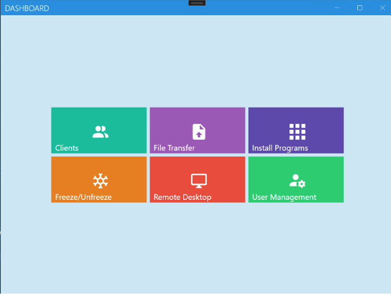
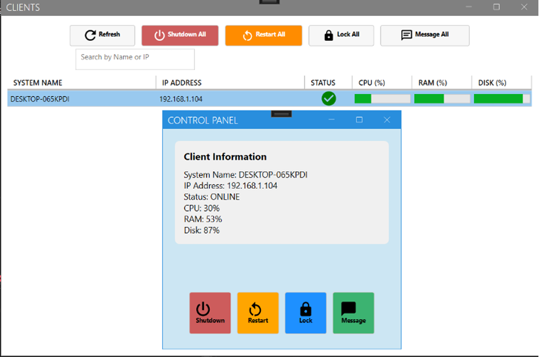

# Network-Management-System
# Network Client Monitoring & Remote Control System

A comprehensive Client-Server desktop application designed for network administrators to monitor, manage, and control client computers over a Local Area Network (LAN). Built as a graduation project using C#, WPF, and Windows Forms.

## 🚀 Key Features

*   **Real-time Hardware Monitoring:** Tracks CPU, RAM, Disk usage, IP, and online/offline status of clients.
*   **Remote Desktop & Control:** Live screen sharing (Client to Server) and full remote mouse/keyboard control.
*   **Screen Mirroring:** Broadcast the server's desktop to all or specific clients simultaneously.
*   **Silent Software Installation:** Push and silently install software on multiple clients remotely using silent switches.
*   **Deep Freeze Management:** Remotely send and execute `.bat` scripts to freeze/unfreeze clients with Administrator privileges.
*   **File Transfer:** Send files to multiple clients concurrently.
*   **System Commands:** Remote Lock, Restart, and Shutdown.
*   **User Management:** Secure admin dashboard with role-based access control (stored in SQLite).

## 🏗️ Architecture & Tech Stack

*   **Server (Admin Panel):** C# (.NET 8), WPF, MahApps.Metro (UI), SQLite (Database).
*   **Client (Agent):** C# (.NET 8), Windows Forms, running in the background (System Tray).
*   **Communication:** Custom TCP Socket protocol using `System.Net.Sockets`, utilizing multiple dedicated ports for different tasks (e.g., Port 5055 for system info, 9090/9091 for screen streaming, 9092 for input control).
*   **Hardware Info:** WMI (Windows Management Instrumentation).
*   **Input Simulation:** WindowsInput & MouseKeyHook.

## 🧠 Challenges & Solutions

*   **VNC Implementation Failure:** Initial attempts to use VNC libraries for screen sharing failed due to native library incompatibilities with modern Windows versions. **Solution:** Developed a custom lightweight screen mirroring technique using compressed frame streaming, achieving a 50-60ms latency.
*   **UI Automation for Silent Installs:** Tried using UI Automation (FlaUI, Pywinauto) to record macros for software installation, but faced limitations with complex setups and Windows security blocks. **Solution:** Pivoted to relying on native silent installation switches (e.g., `/S`, `/quiet`) which proved more reliable.
*   **Security Restrictions:** Windows blocked `.bat` scripts on clients. **Solution:** Implemented Task Scheduler execution with elevated Administrator privileges.

## 📸 Screenshots

## 🛠️ How to Run

1. Clone the repository.
2. Open `Network_Management.sln` in Visual Studio 2022.
3. Build the solution.
4. Run the Server project first, then run the Agent-Client on target machines.
5. Configure the Server IP in the client application (if applicable).
